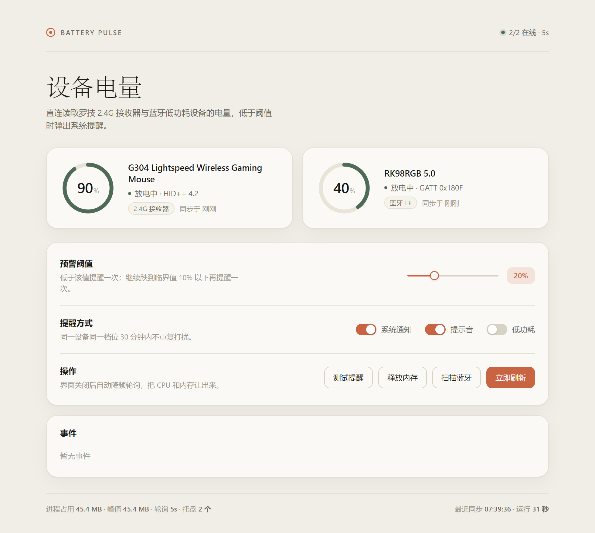
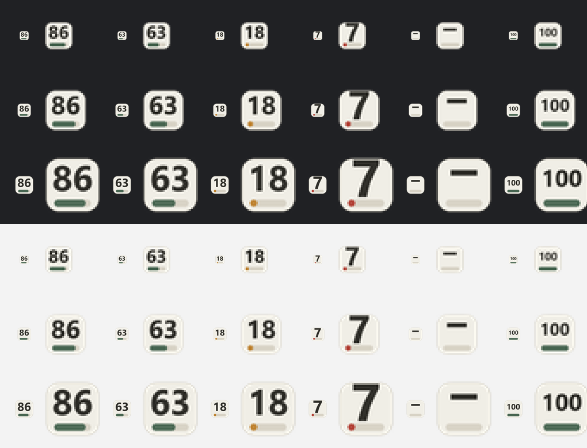
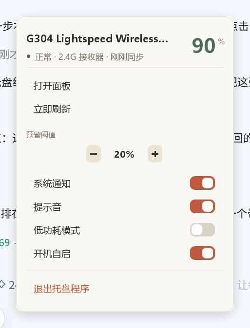

<div align="center">

# Battery Pulse

**Read the real battery level of wireless mice and keyboards on Windows.**

Logitech HID++ 2.0 over a 2.4 GHz receiver · Bluetooth LE GATT · tray-first, ~16 MB idle

[](https://github.com/yogurt/battery-pulse/actions/workflows/build.yml)
[](https://github.com/yogurt/battery-pulse/releases/latest)
[](LICENSE)
[](pyproject.toml)
[](https://github.com/yogurt/battery-pulse/releases/latest)



[English](#english) · [中文](#中文)

</div>

---

## English

Most "battery" utilities only read the system battery driver, so they see nothing for wireless peripherals.
Battery Pulse talks to the devices directly — HID++ 2.0 for Logitech receivers, BLE GATT for Bluetooth keyboards.

| | |
|---|---|
| **Two shapes** | A frameless WebView2 panel (default), or tray-only at ~16 MB RSS |
| **Per-device tray icons** | Cream rounded card + dark percentage + status-coloured bar |
| **Real numbers** | G304 reports 90% straight from `feature 0x1000`, not a driver guess |
| **Graded alerts** | Warn at 20%, critical at 10%, with quiet periods and recovery hysteresis |
| **Zero console** | Ships as a standalone folder; no Python needed on the target machine |

### Download

Grab `BatteryPulse-v*-win64.zip` from [Releases](https://github.com/yogurt/battery-pulse/releases/latest),
unzip anywhere, run `BatteryPulse.exe`.

Requires Windows 10/11 and the [WebView2 Runtime](https://developer.microsoft.com/microsoft-edge/webview2/)
(preinstalled on Windows 11 and on Windows 10 with a modern Edge).

### Supported devices

| Link | Status | Notes |
|---|---|---|
| Logitech HID++ 2.0 (2.4 GHz receiver) | ✅ tested on G304 | Any device exposing `feature 0x1000` |
| Bluetooth LE GATT `0x180F` / `0x2A19` | ✅ tested on RK98 | Standard Battery Service |
| Vendor 2.4 GHz dongles (SINOWEALTH etc.) | ❌ not possible | The dongle only forwards HID keyboard reports; no battery page is exposed |

Run `python tools/probe.py` to see whether a new Logitech device exposes the battery feature.

### Run from source

```bat
python -m venv .venv
.venv\Scripts\python.exe -m pip install -r requirements.txt
.venv\Scripts\pythonw.exe app.py
```

### Build

```bat
build.bat      :: -> dist\BatteryPulse\BatteryPulse.exe
release.bat    :: -> release\BatteryPulse-v<version>-win64.zip
```

### Documentation

- [Implementation notes](docs/ARCHITECTURE.md) — protocol details, DPI traps, a deadlock worth reading about
- [Contributing](CONTRIBUTING.md)
- [Publishing / CI](docs/PUBLISH.md)
- [Changelog](CHANGELOG.md)

### Author

- Blog: [yogurt's blog](https://example.com) <!-- TODO: 换成真实博客地址 -->
- GitHub: [@yogurt](https://github.com/yogurt)

MIT licensed. Not affiliated with Logitech or Royal Kludge.

---

<a id="中文"></a>

## 中文

直接读取无线键鼠**真实电量**的 Windows 小工具。两种运行形态：

- **桌面面板**：无边框 WebView2 窗口，自绘标题栏，Claude 风格暖色界面（默认）
- **托盘常驻**：每只设备一个图标，右键是自绘弹层菜单，内存约 16 MB（自启用这个）

低于阈值弹系统通知。零控制台窗口，可以打包成不依赖 Python 的 exe。




---

## 下载

不想装 Python 的话，直接去 [Releases](https://github.com/yogurt/battery-pulse/releases/latest)
下 `BatteryPulse-v*-win64.zip`，解压后双击 `BatteryPulse.exe`。

要求 Windows 10/11 + [WebView2 运行时](https://developer.microsoft.com/microsoft-edge/webview2/)（Win11 与装过新版 Edge 的 Win10 都已自带）。

---

## 特性

| | |
|---|---|
| **读的是真值** | 罗技走 HID++ 2.0 的 `feature 0x1000`，蓝牙走标准 Battery Service，不是驱动估算 |
| **两种形态** | 桌面面板 / 纯托盘；托盘模式内存约 16 MB，空闲 CPU 0.0% |
| **一设备一图标** | 米白圆角卡 + 深色电量数字 + 底部状态色进度条，深浅任务栏都读得清 |
| **分级预警** | 20% 提醒、10% 临界提醒，带静默期和回升重置，不在阈值边缘反复弹 |
| **便携** | 打包后整个目录拷走就能用，配置和日志写在 exe 旁边，方便备份 |
| **不打扰** | 界面切走 2 分钟自动降频到 60 秒轮询，可开低功耗模式（120 秒） |

---

## 快速开始

```bat
start.bat          :: 启动桌面面板（已在跑则把面板叫到前台）
tray-only.bat      :: 只起托盘，不建窗口（最省内存）
open-ui.bat        :: 唤起面板
stop.bat           :: 关闭

build.bat          :: 打包成 dist\BatteryPulse\BatteryPulse.exe
release.bat        :: 打包并压成可上传 Release 的 zip
```

从源码跑（三行）：

```bat
python -m venv .venv
.venv\Scripts\python.exe -m pip install -r requirements.txt
.venv\Scripts\pythonw.exe app.py
```

托盘交互：

| 操作 | 行为 |
|---|---|
| **左键** | 立刻刷新一次（重新读 HID++ / BLE，不等下一轮轮询） |
| **双击** | 打开 / 唤起面板 |
| **右键** | 弹出 Claude 风格弹层菜单 |
| 悬停 | 提示气泡：`G304 · 90% · 正常` |



菜单里的阈值和开关是**就地生效**的：点完原地重绘、菜单不关，能连着调；`打开面板` / `立即刷新` / `退出程序` 执行完自动收起。ESC 或点菜单外面关闭。`退出托盘程序` 会先摘掉图标，再把 HTTP 服务一起关掉，进程不残留。

### 开机自启

写的是注册表而不是「启动」文件夹快捷方式——后者会先闪一个 cmd 黑框：

```
HKCU\Software\Microsoft\Windows\CurrentVersion\Run
  BatteryPulse = "<...>\.venv\Scripts\pythonw.exe" "<...>\app.py" --tray
```

命令行也能改：`python app.py --autostart on|off|status`，或直接用 `autostart-on.bat` / `autostart-off.bat`。

---

## 支持的设备

| 连接方式 | 状态 | 说明 |
|---|---|---|
| 罗技 HID++ 2.0（2.4G 接收器） | ✅ G304 实测 | 暴露 `feature 0x1000` 的设备都能读 |
| 蓝牙 LE GATT `0x180F` / `0x2A19` | ✅ RK98 实测 | 标准 Battery Service |
| 国产 2.4G 方案（SINOWEALTH 等） | ❌ 无法支持 | 接收器只转发 HID 键盘报文，没有厂商电池页 |

> **RK98 在 2.4G 模式下读不到电量**：它的接收器不暴露任何电池页，电量只有键盘自己的指示灯/驱动界面知道。
> 想在软件里看到实时电量，让键盘走蓝牙通道。G304 没这个限制。

**加新设备**：界面点「扫描蓝牙」，会把真正暴露 `0x180F` 的设备写进配置；
罗技设备先跑 `python tools/probe.py`，能列出设备索引和支持的 feature。

---

## 常见问题

**托盘图标被折叠到 `^` 里了？**
Windows 10 会把新图标默认丢进溢出区，而且没有公开 API 能提升它。程序检测到会弹提示，手动点任务栏的 `^`，把图标拖到任务栏上一次，之后会一直记住。

**点了「打开面板」没反应？**
已修。三个叠加原因（前台锁、找不到隐藏窗口、窗口标题撞车）和修法写在 [实现笔记](docs/ARCHITECTURE.md) 的第 3.3 节。如果面板进程崩了，托盘会弹"面板正在打开…"的气泡，告诉你这次在冷启动 WebView2（要几秒）。

**图标是灰色的 `–`？**
该设备离线。RK98 在 2.4G 模式下必然如此；G304 则是接收器没插或鼠标没开。

**通知不弹？**
Windows 专注助手 / 勿扰模式会拦 Toast；用的是未注册 AppID，部分系统会折叠到通知中心而不是横幅，事件列表里仍有记录。

**服务显示未响应？**
端口被占了。程序会自动顺延到 8732 起的空闲端口，看控制台输出或 `data/config.json` 里的 `port`。

---

## 项目结构

```
battery-pulse/
├─ app.py                 HTTP 服务 + 路由（仅监听 127.0.0.1），--tray 常驻托盘
├─ core/
│  ├─ hidpp.py            HID++ 2.0 协议实现（短/长 collection 配对）
│  ├─ ble.py              WinRT GATT 电量读取 + PnP 发现
│  ├─ manager.py          轮询调度、预警状态机、内存指标、自动回收
│  ├─ tray.py             托盘：两个图标、左键刷新、右键弹菜单（纯 ctypes）
│  ├─ menu.py             Claude 风格弹层菜单（分层窗口 + Pillow 自绘）
│  ├─ desktop.py          WebView2 无边框窗口外壳（窗口操作走 ctypes）
│  ├─ autostart.py        开机自启（HKCU Run）
│  ├─ notify.py           Toast 通知
│  ├─ config.py           便携式配置（data/config.json，自动生成）
│  └─ winps.py            PowerShell 桥（-EncodedCommand，避免引号地狱）
├─ ui/index.html          单文件界面（无构建、无 CDN）
├─ tools/                 诊断与截图脚本（probe / verify_tray / test_menu_* …）
├─ shots/                 README 用的截图
├─ docs/                  实现笔记、发布流程
├─ battery-monitor.spec   PyInstaller 配置（onedir）
├─ build.bat              打包 exe
├─ release.bat            打包 + 压成 Release 用的 zip
├─ push.bat               一键提交并推送
├─ pyproject.toml         元数据 / ruff / pytest
├─ CHANGELOG.md           版本变更
└─ CONTRIBUTING.md        开发与提交约定
```

---

## 参与

- 想改代码：看 [CONTRIBUTING.md](CONTRIBUTING.md)，环境三行就能跑起来
- 想发版 / 传 GitHub：[docs/PUBLISH.md](docs/PUBLISH.md) 有逐步命令
- 想理解它为什么这么写：[docs/ARCHITECTURE.md](docs/ARCHITECTURE.md)
- 版本变更见 [CHANGELOG.md](CHANGELOG.md)

## 关于作者

- 博客：[yogurt 的博客](https://example.com) <!-- TODO: 换成真实博客地址 -->
- GitHub：[@yogurt](https://github.com/yogurt)

如果这个工具帮到了你，点个 Star 就是最好的支持。

## 许可

[MIT](LICENSE)。与罗技（Logitech）、RK（Royal Kludge）无隶属关系，商标归各自所有者。
